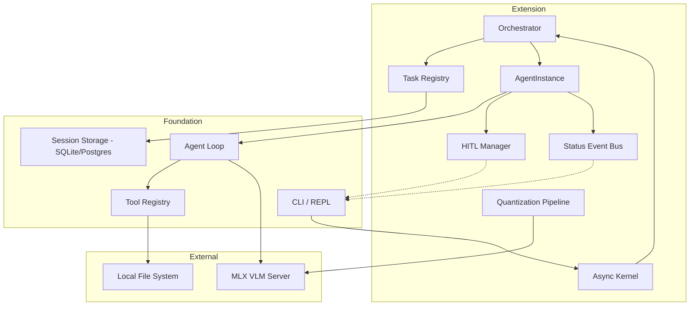

# SRS v0.3: Nomadic Kernel — Consolidated Specification

**Version:** 0.3 (standalone; supersedes SRS-ext-v1.1 – v2.0 and TODO.md)
**Status:** All Functional Components (FC) below are **planned / not implemented**.

## Outline

1. Introduction
2. Core Concepts
3. System Architecture
4. Functional Components
   - 4.1 Orchestration core: FC-1 – FC-4
   - 4.2 Autonomy & goal execution: FC-5
   - 4.3 Process & background orchestration: FC-6
   - 4.4 Extended capabilities: FC-7
   - 4.5 State & history management: FC-8
   - 4.6 TUI & developer experience: FC-9
   - 4.7 File system I/O & context referencing: FC-10 – FC-12
   - 4.8 Runtime quantization: FC-13 – FC-16
   - 4.9 Status feedback layer: FC-17
5. Slash Command Reference
6. Non-Functional / Technical Requirements
7. Milestones
8. Traceability

---

## 1. Introduction
Extends the `nomadic` kernel from a single-agent linear REPL to a multi-agent, task-oriented workspace with Human-In-The-Loop (HITL) safety, parallel execution, rich slash commands, FS-aware context, edge-device model quantization, and live status feedback.

## 2. Core Concepts
- **Orchestrator**: top-level manager for task decomposition, agent assignment, and lifecycle.
- **AgentInstance**: standalone agent loop with its own context, tool registry, and session state.
- **Task**: discrete unit of work with an objective and status.
- **HITL**: synchronization point where the agent pauses for user review before sensitive operations.

## 3. System Architecture



- Synchronous `run_agent_loop` becomes async `AgentInstance.step()` (Thought → Action → Observation), keeping the REPL responsive.
- Foundation keeps VLM communication, tool execution, persistence; extension adds the management layer (Orchestrator, HITL gate).
- Task Registry extends session storage so objectives survive restarts.
- Loop: Reception → Decomposition → Execution (tool_call → HITL check → `AWAITING_REVIEW` if required → execute → inject result) → Completion.

```python
class Orchestrator:
    active_agents: dict[str, AgentInstance]
    task_registry: TaskRegistry
    async def spawn_agent(self, task: Task) -> str: ...
    async def run_parallel(self, tasks: list[Task]): ...

class AgentInstance:
    id; history; status = "IDLE"; current_tool_call
    async def step(self): ...
```

## 4. Functional Components

### 4.1 Orchestration core
**FC-1 Standalone single-agent orchestration (baseline).** Refactor `run_agent_loop` into a state-aware flow: Task → Thought → Tool Call → (optional review) → Execute → Result → Final Answer. Local filesystem/system tool support (Linux/macOS).

**FC-2 Multi-agent parallelism & async execution.** Async kernel with non-blocking background agents; `asyncio` for LLM I/O, thread/process pools for long local tools; agent-to-agent hand-off of sub-tasks/evidence.

**FC-3 HITL & safety profiles.** Interception when a `tool_call` matches a review policy (e.g. all `exec_shell`). Review options: `[A]pprove`, `[R]eject`, `[M]odify`, `[S]kip`. Profiles per agent/session: `strictly_human`, `semi_autonomous`, `fully_autonomous`.

**FC-4 Task & objective management.** Persistent Task Registry (Pending, Active, Completed, Failed); automatic artifact tracking of files created/modified during a task.

### 4.2 Autonomy & goal execution — FC-5
- `/goal`: loop agent to completion without blocking on non-critical tool calls, honoring FC-3 safety profiles.
- `/go`: skip the next user prompt; agent continues its planned actions on current context.
- `/grill-me`: interrogative mode; agent questions the user until ambiguity is resolved before acting.

### 4.3 Process & background orchestration — FC-6
- `/agents`: TUI panel to manage/inspect/spawn parallel background subagents (via `nomadic/orchestrator.py`, FC-2).
- `/tasks`: TUI dashboard to list, monitor, inspect, cancel tasks (via `nomadic/tasks.py`, FC-4).

### 4.4 Extended capabilities — FC-7
- `/browser`: opt-in headless Playwright Chromium (navigation, screenshots, text extraction); tools injected into the registry only when enabled.
- `/btw <query>`: isolated ephemeral agent answering a side question from current state without disrupting the main conversation.

### 4.5 State & history management — FC-8
- `/fork`: deep-copy session and messages (and workspace state) to a new session ID and switch to it.
- `/rewind` (`/undo`): destructive rollback of recent messages/tool executions in SQLite and restoration of agent state to a prior turn.
- `/rename <name>`: rename the active session in `chat_sessions` (inline or interactive).
- Related basics: `/resume` (`/switch`) reloads a prior conversation; `/clear` clears screen and resets thread.

### 4.6 TUI & developer experience — FC-9
- `/diff`: unified git diff of all workspace modifications.
- `/artifacts`: list/inspect/render generated files and reports from the DB artifacts field.
- `/add-dir <path>`: dynamically extend the agent's allowed workspace boundaries.
- `/context`: token breakdown (history vs system prompt) and checkpoint management.
- `/usage`: usage stats and quota/rate-limit tracking across models.
- `/export`: serialize session to JSON or Markdown, or push to the Antigravity GUI (needs API hook or socket).
- Related basics: `/config` (`/settings`) settings overlay, `/help`, `/exit`.

### 4.7 File system I/O & context referencing
**FC-10 FS tooling.** Register `read_file` (full/line-range, large-file safe), `write_file`, `replace_content` (granular/AST-aware), `list_dir` in `ToolRegistry` (e.g. `nomadic/tools/fs.py`). Emits `READING`/`WRITING` events (FC-17).

**FC-11 REPL `@` autocomplete.** In `KernelInput._prompt_multiline`, a custom `Completer` combining slash-command completion with a path completer triggered only by `@`.

**FC-12 Context resolver & injector.** Before `state.add_user()`: parse `@<filepath>` (regex), resolve relative to PWD, validate existence, wrap as `<file path="..."><content>...</content></file>`, append to the prompt or inject as hidden system message. Enforce `ServerConfig.max_context_tokens` / `max_skill_chars`, truncating oversized files.

Order: FC-10 → FC-12 → FC-11.

### 4.8 Runtime quantization
**Objective:** run dense models (e.g. 36B, ~72GB FP16) on memory-constrained Apple Silicon (e.g. 48GB UMA) by quantizing at runtime.

**Model.**
- `M_os_reserve = max(8, 0.25 × M_sys)` GB; `M_avail = M_sys − M_os_reserve`.
- `M_est_model = P × (Q/8) × 1.15 + M_kv_cache`, with `M_kv_cache = 2 × L × H × D × ctx_len × 2 bytes`.

| Params (P) | Min M_avail | Q | Est. footprint |
| :-- | :-- | :-- | :-- |
| ≤ 8B | ≥ 12 GB | 8-bit / FP16 | ~10 GB |
| 8–20B | ≥ 24 GB | 8 / 4-bit | ~14–22 GB |
| 20–40B | ≥ 36 GB | 4 / 3-bit | ~18–26 GB |
| 40–72B | ≥ 36 GB | 3 / 2-bit | ~28–34 GB |

**Flow:** `nomadic serve model=<repo> --quantize` → FC-13 audit → FC-14 detect P → choose Q → cache hit? → (miss) FC-15 convert → FC-16 bootstrap server.

- **FC-13 System resource auditor.** macOS `sysctl -n hw.memsize`; return `M_sys − max(8, 0.25·M_sys)`.
- **FC-14 Model parameter detector.** Fetch `config.json` from Hugging Face Hub (auth token if needed); use explicit param count or derive from `num_hidden_layers`, `hidden_size`, `intermediate_size`.
- **FC-15 Runtime quantizer engine.** If `~/.cache/nomadic/quantized/<repo_id>-<Q>bit/` is missing, run `python -m mlx_lm convert --hf-path <repo> -q --q-bits <Q> -o <dir>` (or `mlx_vlm.convert` for multimodal) as a managed async subprocess; verify `mlx-lm`/`mlx-vlm`; stream logs as `StatusEvent`s.
- **FC-16 Server bootstrapper.** Intercept model paths in `cmd_serve`/`cmd_kernel`, redirect `ServerConfig.model` to the FC-15 output; launch e.g. `python -m mlx_vlm.server --model <dir> --port 8080`.

**CLI:** `--quantize`, `--q-bits {8,4,3,2,auto}` (default `auto`), `--cache-dir`.

### 4.9 Status feedback layer — FC-17
(Previously unnumbered, SRS-ext-v1.3; numbered here for traceability.)
- **Emitter**: `AgentRuntime` gets a thread/async-safe `status_callback(state, context)`; `ToolRegistry.execute()` broadcasts pre/post states.
- **Event bus**: thread-safe `queue.Queue`/`asyncio.Queue` of `StatusEvent` dataclasses, consumed non-blockingly by the UI.
- **Renderer**: `UI.start_status(msg)` / `.stop_status()` using `rich.status.Status` or a `prompt_toolkit` toolbar; transient, never persisted in chat history; replaced by the permanent result block on completion.

| State | Display | Trigger |
| :-- | :-- | :-- |
| `THINKING` | Thinking... | VLM generation active |
| `READING` | Reading codebase... | read-only/lookup tools (`read_skill`, `metadata_search`, `read_file`) |
| `WRITING` | Writing file... | `write_file` |
| `EDITING` | Editing line 45... | `replace_content` / AST edits |
| `EXECUTING` | Running tests... | `exec_shell` |
| `REVIEWING` | Awaiting user review... | blocked by FC-3 HITL |

Phases: A data layer (`AgentStatus`, `StatusEvent`) → B runtime/registry integration → C UI rendering.

## 5. Slash Command Reference

| Group | Commands | FC |
| :-- | :-- | :-- |
| Execution & agent control | `/goal`, `/go`, `/grill-me`, `/agents`, `/tasks`, `/browser` | 5, 6, 7 |
| Conversation & session | `/fork`, `/rewind` (`/undo`), `/resume` (`/switch`), `/clear`, `/rename`, `/btw` | 8, 7 |
| Workspace & system | `/diff`, `/artifacts`, `/add-dir`, `/context`, `/usage`, `/config` (`/settings`), `/export`, `/help`, `/exit` | 9 |

## 6. Non-Functional / Technical Requirements
- Python 3.12+, asyncio core; `concurrent.futures` for blocking tools.
- Persistence: extend SQLite/Postgres with `tasks` and `agent_states`.
- UI: `prompt_toolkit` extended for background status updates and async prompts.
- Quantization targets macOS / Apple Silicon (MLX).

## 7. Milestones
- [ ] M1: Async `AgentInstance` extracted from `run_agent_loop` (FC-1, FC-2)
- [ ] M2: HITL interception and review commands (FC-3)
- [ ] M3: Orchestrator, task registry, parallelism (FC-2, FC-4)
- [ ] M4: Status feedback layer (FC-17) and FS tools (FC-10)
- [ ] M5: Context resolver and `@` autocomplete (FC-12, FC-11)
- [ ] M6: Autonomy commands (FC-5)
- [ ] M7: `/agents`, `/tasks` dashboards (FC-6)
- [ ] M8: History management (FC-8)
- [ ] M9: DX commands (FC-9) and extended capabilities (FC-7)
- [ ] M10: Runtime quantization (FC-13 – FC-16)

## 8. Traceability

| Source | Merged into |
| :-- | :-- |
| SRS-ext-v1.1 | §2, §3, FC-1–4, §6, §7 |
| SRS-ext-v1.2-commands_basic | §5, FC-5–9 |
| SRS-ext-v1.3-agent_states | FC-17 |
| SRS-ext-v1.4-context_reference-fs_io | FC-10–12 |
| SRS-ext-v1.5-quantized_runer | FC-13–16 |
| SRS-ext-v2.0, TODO.md | FC-5–9 |
